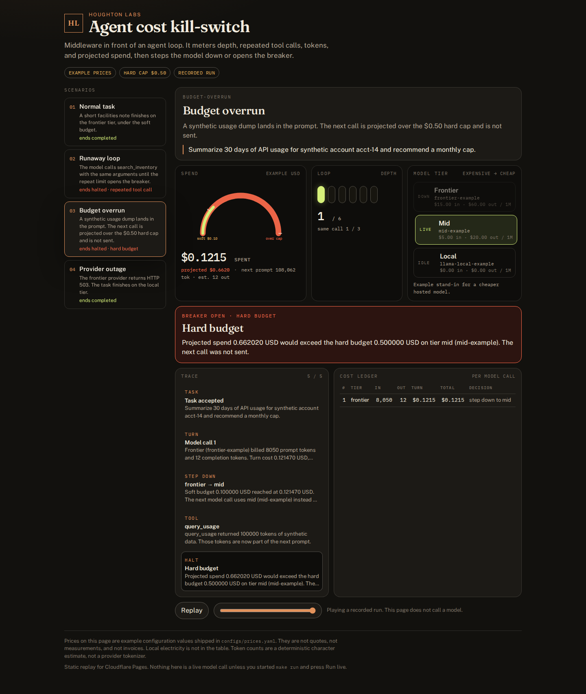
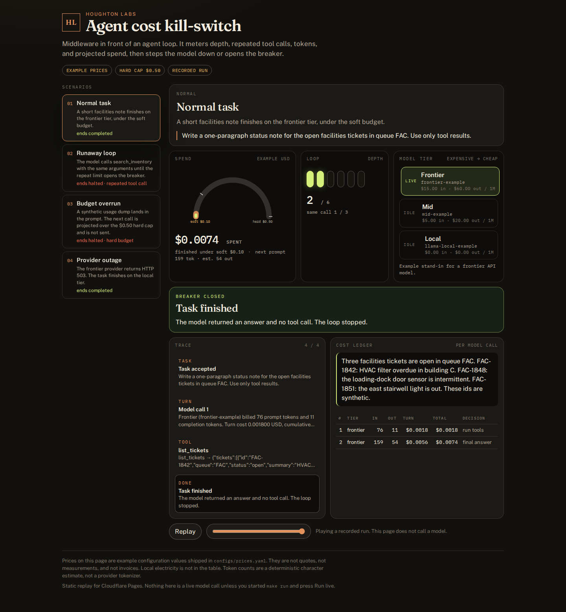
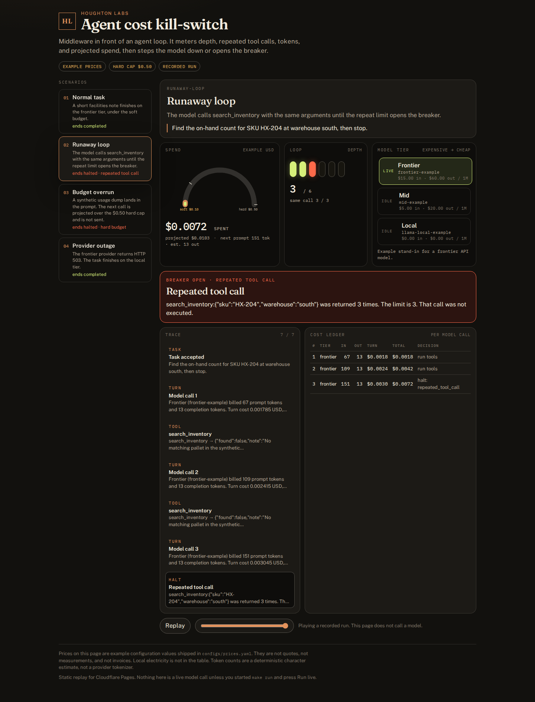
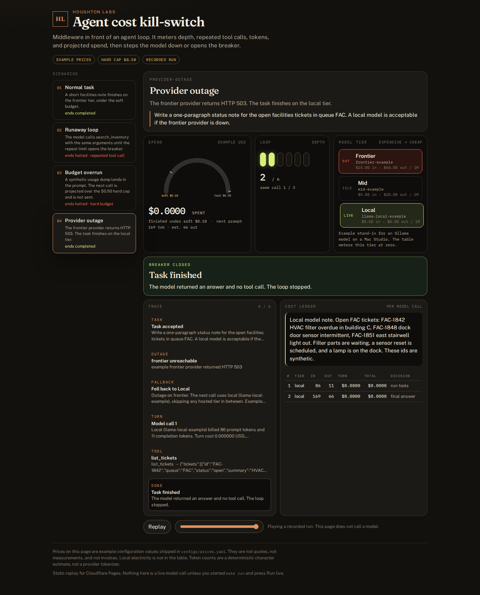

# agent-cost-killswitch

Middleware that meters an agent loop and either steps it down to a cheaper model or opens the breaker.

It tracks loop depth, repeated identical tool calls, tokens, and projected spend per task. A soft budget moves the call down a tier (frontier, then mid, then a local Ollama model). A hard budget, a depth ceiling, or a repeat limit halts the task and returns a structured reason, plus a cost ledger.



## Why it matters

An agent loop fails expensively in two ways. It keeps a frontier model on a job a smaller model can finish, and it gets stuck issuing the same tool call. Asking the model that is looping to please stop is the wrong layer. The cap belongs in the middleware, and it belongs on the task, so one runaway cannot own the day's spend.

The dollar figures in this repo are **example configuration values** from [`configs/prices.yaml`](configs/prices.yaml). They are not quotes and not invoices.

## Quick start

```bash
make install
make test          # pytest, no API keys
make record        # regenerate site/data from the synthetic scenarios
make run           # http://127.0.0.1:8766
```

`make run` serves the same static site Cloudflare Pages serves, and adds `POST /api/run` so you can re-execute a scenario on the local engine. The recorded runs use a deterministic mock provider. Nothing in CI calls a model.

```bash
python -m killswitch run --all
HL_DATASET_URI=file://$PWD/demo/data/scenarios.json make run
```

Optional local model, for the `local` tier only:

```bash
HL_OLLAMA_HOST=http://127.0.0.1:11434 python -m killswitch ask "Say hello in five words"
```

`make record` ignores `HL_OLLAMA_HOST` so `site/data` stays reproducible.

## How it works

```mermaid
flowchart TD
  task[Task] --> depth{At max loop depth?}
  depth -->|yes| haltDepth[Halt: loop_depth]
  depth -->|no| quote[Price the prompt already in context plus an estimated completion]
  quote --> hard{Projected spend over the hard budget?}
  hard -->|yes| haltHard[Halt: hard_budget. Call is not sent]
  hard -->|no| call[Call the provider on the current tier]
  call --> outage{Provider outage?}
  outage -->|already on local| haltOut[Halt: provider_outage]
  outage -->|not yet on local| local[Switch to the local tier and retry]
  local --> call
  outage -->|no| bill[Append a cost ledger row]
  bill --> rep{Same tool call at the repeat limit?}
  rep -->|yes| haltRep[Halt: repeated_tool_call. Tool is not run]
  rep -->|no| over{Actual spend over the hard budget?}
  over -->|yes| haltOver[Halt: hard_budget, overshoot flagged]
  over -->|no| done{Final answer?}
  done -->|yes| finish[Return the answer and the ledger]
  done -->|no| soft{Spend at the soft budget, and a cheaper tier exists?}
  soft -->|yes| step[Step down one tier]
  soft -->|no| tools[Run the tools]
  step --> tools
  tools --> depth
```

The default policy in [`configs/policy.yaml`](configs/policy.yaml):

| knob | default | what it does |
|---|---|---|
| soft budget | $0.10 | after a call whose cumulative spend has reached this, the next call uses the next cheaper tier |
| hard budget | $0.50 | if the next call's projection would cross this, the call is not sent. If a completion crosses it anyway, the loop stops and the ledger flags an overshoot |
| loop depth | 6 | model responses per task. The next call is not sent |
| identical tool calls | 3 | same tool name and canonical arguments. The response that hits the limit is billed and not executed |
| ladder | frontier → mid → local | one step per soft-budget crossing. An outage skips straight to local |

Projection uses the prompt already sitting in the messages, which is known, plus the previous completion's length as a stand-in for the next completion. Before any call, that stand-in is `planning_completion_tokens` (256). Token counts are `(characters + 3) // 4`. The same text always yields the same count. A provider tokenizer will differ.

The mock provider replays `demo/data/scenarios.json`. It does not read the task and improvise. That is what makes the four runs identical in CI. Tools return synthetic fixtures from `demo/data/tools.json`.

## Sample results

Recorded 2026-10-29 with `make record`. Amounts use the example price table: frontier $15 / $60 per million input / output tokens, mid $5 / $20, local $0 / $0.

| scenario | outcome | depth | final tier | spent (example USD) | projected (example USD) | what happened |
|---|---|---|---|---|---|---|
| normal | completed | 2 | frontier | 0.007425 | 0.013050 | A short facilities note finishes on the frontier tier, under the soft budget. |
| runaway-loop | halted · repeated_tool_call | 3 | frontier | 0.007245 | 0.010290 | The model calls search_inventory with the same arguments until the repeat limit opens the breaker. |
| budget-overrun | halted · hard_budget | 1 | mid | 0.121470 | 0.662020 | A synthetic usage dump lands in the prompt. The next call is projected over the $0.50 hard cap and is not sent. |
| provider-outage | completed | 2 | local | 0.000000 | 0.000000 | The frontier provider returns HTTP 503. The task finishes on the local tier. |







## Design decisions

- **The hard budget opens the breaker.** It does not silently spend the rest of the cap on a cheaper model. The soft budget is what steps down, early enough that a cheaper tier can still finish inside the cap. If you want "at $0.50, switch to local," lower the soft budget and raise the hard one.
- **Soft budget watches money already spent.** The pre-call quote is for the hard cap. A first call can be priced above the soft line; the step down happens before the call after that.
- **One tier per crossing.** Frontier becomes mid, and mid would become local on a later call. An outage is not a price event, so it jumps to local and skips mid.
- **The repeat key is canonical JSON** with sorted keys. `{"warehouse","sku"}` and `{"sku","warehouse"}` are the same call.
- **Providers are pluggable.** `MockReplayProvider` is the default. `OllamaProvider` speaks to `POST /api/chat` with the stdlib, and `RoutingProvider` sends only the local tier there when `HL_OLLAMA_HOST` is set. Hosted tiers stay on the script.
- **The ledger stores the price-table label** (`example`) and the disclaimer, so a recorded run cannot be mistaken for a bill.

## Caveats

- Every dollar figure is an example configuration value. Edit `configs/prices.yaml` to match a contract. Keep the label as `example` or `config`. The middleware never fetches live prices.
- The character counter is not a model tokenizer. Real bills will not match these token counts.
- The mock will not adapt if you edit a task instruction. It replays the script next to that instruction. The script is the point of the demo.
- A completion longer than the last one can cross the hard budget after the call returns. The ledger sets `overshoot` and does not take another turn. The budget scenario in the site is the other case: the call is refused before it is sent.
- The local tier is metered at $0.00 in the example table. Electricity, hardware, and a Mac Studio's time are not in the price.
- These are four synthetic tasks, not a traffic study. Ticket ids (`FAC-1842`) and the SKU (`HX-204`) are fictional.
- There is no monthly rollup. One task, one ledger.

## Layout

```
killswitch/     policy, price table, ledger, mock and Ollama providers, the loop
configs/        prices.yaml (example figures) and policy.yaml ($0.50 hard cap)
demo/data/      synthetic scenarios, tool fixtures, summary.json
site/           static replay. index.html + assets, data/*.json
docs/images/    screenshots from scripts/screenshots.py (headless Chromium)
tests/          pytest, no keys
```

Fonts in `site/assets/fonts/` are Fraunces, Public Sans, and IBM Plex Mono, under the SIL Open Font License. License texts sit next to the files.

## Live demo

Live demo: https://agent-cost-killswitch.pages.dev (placeholder, not deployed yet)

## Cloudflare Pages

Static site root: `site/`. Recorded runs: `site/data/*.json`, mirrored summary at `demo/data/summary.json`. No build step and no backend. `wrangler.toml` sets `pages_build_output_dir = "site"`.

Suggested Pages project: **agent-cost-killswitch** · Production branch `main` · Framework none · Root directory `site` · no build command.

## License

MIT, see [LICENSE](LICENSE).
